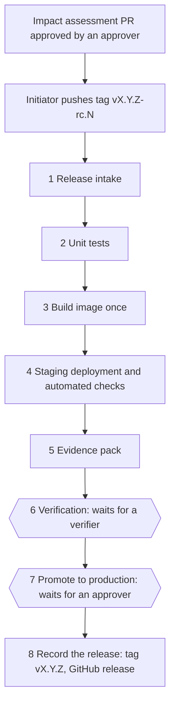

# GxP DevOps framework: design

| | |
|---|---|
| Status | Draft, describes framework v0.1 |
| Last updated | 2026-10-19 |
| Scope | Internally developed web applications built as container images and run on Azure |

## 1. Purpose

A reusable, versioned release process for GxP-relevant web applications. Each application repository calls the
framework's GitHub workflow. The framework controls the mandatory sequence: checks, a single build, staging
verification, evidence, human verification and approval, and promotion to production. It records which
framework version governed each release.

GitHub is the orchestration, dashboard and traceability layer. Official controlled documents and signatures
stay in the eQMS (Dot Compliance) and are referenced by ID. GitHub is not the QMS.

## 2. Principles

1. **Build once, promote the same artifact.** Each release candidate is built exactly once into one container
   image. The image digest (`sha256:…`) is its identity. STAGING and PRODUCTION run that digest; nothing is
   rebuilt for production.
2. **Configuration is not built in.** The image contains only immutable facts about the build (commit, build
   ID). Environment, release label and settings are supplied at deploy time. Non-secret configuration is
   versioned and its hash is recorded, because it is part of the validated state.
3. **Risk-based validation.** Every release gets a GxP impact assessment. The assessment, not the version
   number, decides the validation path (abbreviated, targeted, full). This follows the risk-based approach of
   FDA CSA and GAMP 5 (2nd edition).
4. **Two different people.** The person who starts a release cannot approve it, and the verifier cannot also
   approve it.
5. **Verify, don't trust.** The framework re-checks approvals and evidence through the GitHub API and SHA-256
   hashes instead of trusting repository settings, files or inputs supplied by the application repository.
6. **One run, one view.** A release candidate is one workflow run. Its page shows every stage: passed,
   waiting for a person, or not started. Every release ends with a release record linking requirement → test
   → result → approval → running image.

## 3. Architecture

### Repositories

| Repository | Contains |
|---|---|
| `gxp-devops-framework` | The reusable workflow `gxp-release.yml`, its tests, this design, the changelog. Released as version tags (`v0.1.0`). |
| Application repo (e.g. `gxp-demo-app`) | Source, Dockerfile, tests, `deploy/*.env`, `.gxp/roles.yml`, `validation/<version>/`, one small caller workflow pinned to a framework version, and the environments `gxp-verification` and `gxp-production`. |

### What an application must provide

| Item | Purpose |
|---|---|
| `Dockerfile` | Builds the image. Accepts build args `GIT_COMMIT` and `BUILD_ID`. |
| `GET /health` | Returns HTTP 200 when the application is up. |
| `GET /version` | Returns JSON with at least `commit`, `environment` and `release`. The framework uses it to verify what is actually running. |
| Runtime configuration | Reads `APP_ENVIRONMENT` and `APP_RELEASE_VERSION` (set by the framework) and its own settings from environment variables at startup. |
| Unit tests with JUnit XML | Test names start with the requirement ID they verify, e.g. `[URS-001] limits are inclusive`. |
| `deploy/staging.env`, `deploy/production.env` | Non-secret configuration per environment. |
| `.gxp/roles.yml` | Who may start releases (`initiators`), verify them (`verifiers`) and approve them (`approvers`). |
| `validation/<version>/impact-assessment.yml` | Impact assessment, merged through an approved PR before the release starts. |
| Environments `gxp-verification`, `gxp-production` | Required reviewers; `gxp-production` with "Prevent self-review". |

### System boundary

The target application architecture is a frontend container (built from Lovable) that talks to MuleSoft APIs,
which talk to a database in Azure. A release is validated against one combination of these. v0.1 builds and
promotes the frontend container only. Recording and checking the MuleSoft API and database schema versions is
planned (see roadmap).

## 4. Release flow

Everything from step 1 to step 8 is one workflow run, named `GxP release vX.Y.Z-rc.N`.

| Job | What happens | Stops the release when |
|---|---|---|
| 1 Release intake | Identifies the framework version from the OIDC token. Checks the tag, that the commit is on the default branch, that the initiator is allowed, that the impact assessment is valid and was merged through an approved PR, and that both gate environments exist with required reviewers. | Framework not referenced by a version tag; tag not `vX.Y.Z-rc.N`; commit not on main; version already released; initiator not listed; impact assessment missing, invalid or not approved; gates missing or misconfigured. |
| 2 Unit tests | Runs the app's tests, summarises JUnit results per requirement ID. | Any test fails, or no results are found. |
| 3 Build image once | Builds and pushes one image, records its digest, confirms the registry holds exactly that digest. | The candidate was already built (a re-run must not create a second image). |
| 4 Staging | Deploys the digest to the `gxp-staging` environment with the staging configuration and checks: the running container uses the digest, `/health`, `/version` (commit, environment, release), home page text. Cancels older release runs still waiting at a gate. | Any check fails. |
| 5 Evidence pack | Assembles `release-candidate.json` and all evidence with a `SHA256SUMS` list into one artifact. | Missing evidence or configuration. |
| 6 Verification | Waits for a reviewer of `gxp-verification`. The verifier checks the candidate and approves with the comment `PASS <reference>`, where the reference points to the verification record (in the eQMS). The job then checks the recorded approval. | No approval recorded, rejection, verifier not listed, comment not `PASS <reference>`, or staging now runs a newer candidate. |
| 7 Promote to production | Waits for a reviewer of `gxp-production`. Checks the approver is listed and is neither the initiator nor the verifier, that staging still runs this candidate and that the registry still holds the digest. Deploys the digest with the production configuration, repeats the checks, tags the image with the version without changing the digest. | Any check fails. |
| 8 Record the release | Verifies the evidence pack against its SHA-256 list, creates tag `vX.Y.Z` on the candidate's commit and a GitHub release with `release-record.json`, an evidence zip and `SHA256SUMS`. | Evidence altered. |

A rejected candidate is fixed on main and re-tagged as the next `-rc.N`. Once the new candidate reaches
staging, the old run is cancelled.

## 5. Roles and segregation of duties

| Role | Typical person | Does |
|---|---|---|
| Initiator | Technical owner | Writes the impact assessment, pushes the release candidate tag. |
| Verifier | Technical owner or tester | Verifies the candidate and approves the `gxp-verification` gate with `PASS <reference>`. |
| Approver | Business / process owner (QA for high impact, if Quality requires it) | Approves the impact assessment PR and the `gxp-production` gate. |

Rules enforced by the framework:

- The initiator must be listed under `initiators`.
- The verification gate must be approved by someone listed under `verifiers`.
- The production gate must be approved by someone listed under `approvers` who is neither the initiator
  nor the verifier. GitHub's "Prevent self-review" on `gxp-production` blocks the initiator as well.
- An impact assessment PR approval counts only if the approver is listed in `.gxp/roles.yml` as it was before
  the PR, approved the final commit, and did not open or contribute to the PR. A PR that changes
  `.gxp/roles.yml` cannot serve as an impact assessment approval.

Whether a release may be approved without QA is a decision for Quality (see open questions).

## 6. Records

| Record | Where | Written by |
|---|---|---|
| `validation/<v>/impact-assessment.yml` | Git, via reviewed PR | Initiator |
| Verification result and reference | Approval comment on `gxp-verification`, copied into the release record | Verifier |
| `release-candidate.json` | Evidence pack of the run | Framework |
| `release-record.json` | GitHub release asset and run artifact | Framework |
| Evidence pack (`gxp-evidence-<tag>`) | Actions artifact (90 days in v0.1) and evidence zip on the GitHub release | Framework |

### Impact assessment (`gxp-impact-assessment/v1`)

| Field | Values |
|---|---|
| `version` | The release version, quoted (`"1.4.0"`) |
| `change_control_id` | eQMS change record ID |
| `summary`, `rationale` | Free text |
| `change_type` | `new-system`, `feature`, `fix`, `cosmetic`, `configuration`, `infrastructure` |
| `gxp_impact` | `none`, `low`, `medium`, `high` |
| `validation_path` | `abbreviated`, `targeted`, `full`. High requires full; medium requires targeted or full. |
| `impacted_requirements` | Requirement IDs; may be empty only when impact is `none` |

### Release record (`gxp-release-record/v1`)

Application, version, candidate tag, commit, initiator; framework version and commit; image reference and
digest; impact assessment summary, hash and approval; configuration hashes; unit test totals and requirement
traceability; staging and production check results; verifier and verification reference; production approver;
run link; release time.

## 7. Controls and enforcement

| Control | v0.1 mechanism | Later |
|---|---|---|
| Only approved releases reach production | Required reviewers on `gxp-production`; the framework re-checks the recorded approval and roles | Production Azure identity trusts only the framework's workflow at approved versions (OIDC `job_workflow_ref`) |
| Verification before approval | `gxp-verification` gate before `gxp-production`; comment must be `PASS <reference>` | Reference checked against the eQMS |
| Same image in staging and production | Deploy by digest, compare running image, registry digest checks | Build provenance attestations, verified at promotion |
| Evidence not altered | SHA-256 of every evidence file, checked before the release record is written | Evidence in write-once Azure Blob storage |
| Separation of duties | Prevent self-review on `gxp-production` plus the framework rules in section 5 | Central roles registry, branch and tag rules, CODEOWNERS |
| Framework version known | OIDC claims `job_workflow_ref` and `job_workflow_sha` | Immutable framework releases |
| Only the latest candidate | A candidate reaching staging cancels older waiting runs; gates reject superseded candidates | Staging deployment lock in Azure |
| Gates cannot be skipped by misconfiguration | Intake checks the environments; gates fail when no approval was recorded | |

## 8. Known limitations of v0.1

- **STAGING and PRODUCTION are simulated** by running the image on the GitHub runner. Manual verification means
  reviewing the evidence or running the exact image locally by digest.
- **Gate waiting time is limited.** GitHub fails a job that waits more than 30 days for approval, and a run
  cannot exceed 35 days. A candidate that waits longer must be re-tagged as the next `-rc.N`.
- **Environment gates on private repositories need GitHub Enterprise.** The test organization uses public
  repositories until the license is available.
- **Repository rules are not configured yet.** Someone with write access can change the caller workflow or
  `.gxp/roles.yml` directly on main. v0.1 detects mistakes and casual tampering. Protection against a
  malicious repository writer comes from the Azure identity binding (v0.3) and repository rules.
- **Approval is a GitHub review, not an electronic signature.** It is a technical release control that mirrors
  the formal approval in the eQMS.
- **Evidence retention is 90 days** (Actions artifacts) plus the GitHub release assets. Long-term retention
  needs write-once storage (v0.7).
- **No security scanning, Playwright, performance tests or attestations yet.**

## 9. Framework versioning

- The framework is released as tags `vMAJOR.MINOR.PATCH`. Applications pin a tag; the intake rejects branches.
- Pre-release tags (`v0.1.0-beta.2`) are allowed for testing and are flagged as "not for GxP use" in every
  record.
- Every framework change is itself a controlled change with an impact assessment for the consuming
  applications. A framework upgrade in an application is a change to that application's release process.
- Every framework version runs its own tests (actionlint and workflow step tests) on its tag.
- Once Enterprise is available, framework releases are published as immutable releases.

## 10. Roadmap

| Version | Scope |
|---|---|
| v0.1 | Single-run release flow on GitHub with simulated environments, environment gates, evidence and release record |
| v0.2 | Central roles registry, repository and tag rules, change report since the last release flagging GxP-critical paths |
| v0.3 | Azure: ACR, OIDC login, Container Apps staging and production by digest, identity bound to framework version, runners inside the Azure network |
| v0.4 | Security: Semgrep, gitleaks, Trivy (dependencies, image, SBOM), build attestations, vulnerability policy with documented exceptions |
| v0.5 | Playwright end-to-end, authorization and performance tests against staging; full traceability matrix |
| v0.6 | Test selection by impact assessment; MuleSoft API and database schema versions in the record |
| v0.7 | Write-once evidence storage, production drift check |
| v0.8 | Emergency change, rollback and configuration-only change paths |
| v1.0 | The framework's own validation package and a pilot application |

## 11. Decision log

| ID | Decision | Reason |
|---|---|---|
| D-01 | Build once, deploy by digest | The validated artifact must be the one in production. |
| D-02 | Releases start with a pushed tag `vX.Y.Z-rc.N` | Team preference; prerequisites are checked at intake. |
| D-03 | One workflow run per candidate, with environment gates for verification and production approval, re-verified by the framework | The whole release must be visible in one place. Replaces the PR-based approval of beta.1, which was chosen for the free plan; the test organization now uses public repositories and Enterprise is expected. |
| D-04 | Release label and environment supplied at deploy time | Promoting without rebuilding must not leave "rc" in production. |
| D-05 | Impact assessment merged before the candidate is built | Scope is agreed before testing starts. |
| D-06 | A candidate reaching staging cancels older runs waiting at a gate | Staging holds one candidate at a time. |
| D-07 | Framework pinned by tag, identified through OIDC claims | The calling repository cannot misreport the framework version. |
| D-08 | Lovable preview is the DEV environment; the framework manages STAGING and PRODUCTION | Development happens in Lovable. |
| D-09 | Open-source scanners in v0.4 | GitHub code scanning is a paid add-on even with Enterprise. |
| D-10 | eQMS stays the system of record; GitHub references its IDs | GitHub approvals are not Part 11 signatures. |
| D-11 | Verification is recorded as the `gxp-verification` approval comment `PASS <reference>` | The detailed verification record belongs in the eQMS; the run keeps the result, the verifier and the reference. |

## 12. Open questions

1. Can releases be approved by the business/process owner, with QA only for high-impact changes? (Quality)
2. Evidence retention period. (Quality)
3. Position on AI-generated code from Lovable. (Quality)
4. Enterprise Managed Users or regular accounts with SSO; does Lovable work with managed users?
5. Lovable on a `develop` branch with release PRs into main, or Lovable on main?
6. Ownership of MuleSoft deployments and database schema changes; is there a staging MuleSoft environment?
7. Must any application go live before the Supabase migration?
