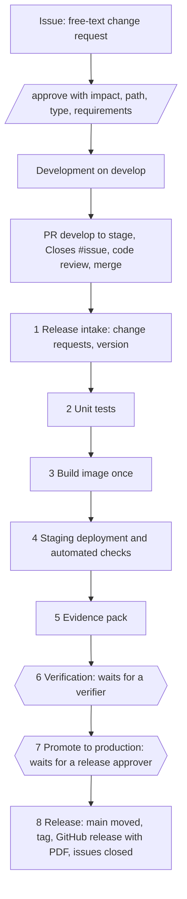

# GxP DevOps framework: design

| | |
|---|---|
| Status | Draft, describes framework v0.2 |
| Last updated | 2026-10-20 |
| Scope | Internally developed web applications built as container images and run on Azure |

## 1. Purpose

A reusable, versioned change and release process for GxP-relevant web applications. Each application
repository calls the framework's GitHub workflows. The framework controls the mandatory sequence from a change
request to production: approval of the request, code review, checks, a single build, staging verification,
evidence, human verification and approval, promotion to production and closure of the request. It records which
framework version governed each release.

GitHub is the orchestration, dashboard and traceability layer. Change requests are informal GitHub issues.
Where a formal change record is required, it lives in the eQMS (Dot Compliance) and is referenced by ID.

## 2. Principles

1. **Every change traces to an approved request.** Code reaches validation only through a reviewed pull
   request that references an approved change request.
2. **Build once, promote the same artifact.** Each candidate is built exactly once into one container image.
   The image digest (`sha256:…`) is its identity. STAGING and PRODUCTION run that digest; nothing is rebuilt.
3. **Branches mirror environments.** `develop` is DEV, `stage` is what is validated in STAGING, `main` is
   exactly what runs in PRODUCTION. Only the release run moves `main`.
4. **Configuration is not built in.** The image contains only immutable facts (commit, build ID). Environment,
   release label and settings are supplied at deploy time. Non-secret configuration is versioned and hashed.
5. **Risk-based validation.** Every change request is assessed when it is approved (impact, validation path,
   affected requirements). The highest impact in a release decides its validation path. This follows the
   risk-based approach of FDA CSA and GAMP 5 (2nd edition).
6. **Separation of duties.** Nobody approves their own request, reviews their own code, or approves a release
   they wrote code for or verified.
7. **Verify, don't trust.** The release run re-derives every approval from its source (issue comments, reviews,
   gate approvals) instead of trusting labels, files or repository settings.
8. **One run, one view.** A release candidate is one workflow run. Its page shows every stage: passed, waiting
   for a person, or not started. Every release ends with a PDF report and a release record.

## 3. Architecture

### Repositories and branches

| Repository / branch | Contains |
|---|---|
| `gxp-devops-framework` | Reusable workflows `gxp-release.yml` and `gxp-change-request.yml`, their tests, this design, the changelog. Released as lightweight version tags. |
| Application repo | Source, Dockerfile, tests, `deploy/*.env`, `.gxp/roles.yml`, `docs/requirements.md`, two caller workflows pinned to a framework version, environments `gxp-verification` and `gxp-production`. |
| `develop` | Work in progress. Lovable works here; its preview is DEV. |
| `stage` | Receives pull requests from `develop`. Every push starts a release run. |
| `main` | Exactly what runs in production. Moved only by the release run, fast-forward to the validated commit. |

### What an application must provide

| Item | Purpose |
|---|---|
| `Dockerfile` | Builds the image. Accepts build args `GIT_COMMIT` and `BUILD_ID`. |
| `GET /health`, `GET /version` | Health, and build identity (`commit`, `environment`, `release`) so the framework can verify what is running. |
| Runtime configuration | Reads `APP_ENVIRONMENT`, `APP_RELEASE_VERSION` (set by the framework) and its own settings at startup. |
| Unit tests with JUnit XML | Test names start with the requirement ID they verify, e.g. `[URS-001] limits are inclusive`. |
| `deploy/staging.env`, `deploy/production.env` | Non-secret configuration per environment. |
| `.gxp/roles.yml` (schema `gxp-roles/v2`) | `change_approvers`, `verifiers`, `release_approvers`. Read from `main`. |
| Caller workflows | `release.yml` (push to `stage`) and `change-requests.yml` (issue events). |
| Environments | `gxp-verification` and `gxp-production` with required reviewers; `gxp-production` with "Prevent self-review". |

### System boundary

The target application architecture is a frontend container (built from Lovable) that talks to MuleSoft APIs,
which talk to a database in Azure. v0.2 builds and promotes the frontend container only. Recording and checking
the MuleSoft API and database schema versions is planned (see roadmap).

## 4. Change and release flow

### Change request

| Step | What happens |
|---|---|
| Request | Anyone opens an issue in free text. `gxp-change-request.yml` labels it `cr:new` and explains how to approve. |
| Approval | A change approver (not the requester) comments `/approve` with `impact`, `path`, `type`, `requirements`, `reason` and optionally `cc`. The workflow checks the rules and labels it `cr:approved`, `impact:…`, `type:…`; invalid approvals get a reply explaining what is wrong. `/reject <reason>` closes the issue as not planned. |
| Edit | Editing the request text after approval withdraws the label `cr:approved` and asks for a new approval. |

### Release run (`gxp-release.yml`, on push to `stage`)

| Job | What happens | Stops the release when |
|---|---|---|
| 1 Release intake | Identifies the framework version from the OIDC token. Collects every commit on `stage` that is not on `main`, the pull requests that brought them and the change requests those PRs reference. Applies the rules (below). Derives the version from the previous release and the change request types, and the impact from the highest one. Checks that the gate environments exist. | Run not on `stage`; `main` not contained in `stage`; nothing new; any rule broken; version already released; gates missing or misconfigured. |
| 2 Unit tests | Runs the tests, summarises JUnit results per requirement ID. | Any test fails, or no results are found. |
| 3 Build image once | Builds and pushes one image tagged with the candidate label (`0.3.0-rc.57`), records its digest. | The candidate was already built. |
| 4 Staging | Deploys the digest to `gxp-staging` and checks the running image, `/health`, `/version`, home page. Cancels older runs waiting at a gate. | Any check fails. |
| 5 Evidence pack | `release-candidate.json` (scope, change requests, PRs, code authors, checks, hashes) and all evidence with a `SHA256SUMS` list. | Missing evidence or configuration. |
| 6 Verification | Waits for a verifier; approval comment `PASS <reference>`. | No approval recorded, rejection, verifier not listed, bad comment, or staging runs a newer commit. |
| 7 Promote to production | Waits for a release approver who is neither the verifier nor a code author. Deploys the same digest with production configuration, repeats the checks, tags the image with the version. | Any check fails. |
| 8 Release | Verifies the evidence, writes `release-record.json` and the PDF report, moves `main` (fast-forward) to the validated commit, tags `vX.Y.Z`, publishes the GitHub release, comments on and closes the change requests (`cr:released`). | Evidence altered, or `main` cannot be fast-forwarded. |

Intake rules:

- Every commit on `stage` that is not on `main` arrived through a merged pull request into `stage`.
- Every such pull request references at least one change request (`Closes #123`) and has an approving review
  of its final commit by a change approver who is not its author and did not author any of its commits.
- Every referenced change request is an open issue whose latest decision is a valid `/approve` by a change
  approver who is not the requester, with valid fields, a comment that was never edited, and a request text not
  edited after the approval. A later `/reject` withdraws an earlier approval; a later `/approve` restores it.
- Version: from the latest `vX.Y.Z` tag on `main`: `breaking` → next major, `feature` → next minor,
  `fix` → next patch (highest type wins). Without an earlier release the base is `0.0.0`.

A gate that failed for a procedural reason can be retried with *Re-run failed jobs*; the newest approval counts
and the image is not rebuilt. A rejected candidate is fixed on `develop` and merged to `stage` again.

## 5. Roles and segregation of duties

| Role (`.gxp/roles.yml`) | Typical person | Does |
|---|---|---|
| Requester | Anyone | Opens the issue. |
| `change_approvers` | IT | Approves change requests, reviews pull requests to `stage`. |
| Developer | Business user (Lovable) | Implements on `develop`, opens and merges the pull request after review. |
| `verifiers` | Business user or tester | Verifies on staging and approves `gxp-verification`. |
| `release_approvers` | IT | Approves `gxp-production`. |

Rules: the requester cannot approve their request; a code author cannot review their pull request; the release
approver can be neither a code author of the release nor its verifier. GitHub's "Prevent self-review" on
`gxp-production` additionally blocks the person whose merge started the run, so the PR author merges after
review.

| Team | Request | Approve request, review code | Develop | Verify | Approve release |
|---|---|---|---|---|---|
| 2 people | Business | IT | Business | Business | IT |
| 4 people | Business A | IT A | Business A | Business B | IT B |

A pull request from `develop` to `stage` carries everything on `develop`, so all the changes it contains must
have approved requests. The simplest practice is one change request at a time per application.

Whether this model is sufficient without QA involvement is a decision for Quality (see open questions).

## 6. Records

| Record | Where | Written by |
|---|---|---|
| Change request and its approval | GitHub issue and its `/approve` comment | Requester, change approver |
| Code review | Pull request review | Change approver |
| Verification result and reference | Approval comment on `gxp-verification` | Verifier |
| `release-candidate.json` | Evidence pack of the run | Framework |
| `release-record.json` | GitHub release asset and run artifact | Framework |
| `release-report-vX.Y.Z.pdf` | GitHub release asset and run artifact; can be attached to an eQMS record | Framework |
| Evidence pack (`gxp-evidence-<candidate>`) | Actions artifact (90 days in v0.2) and evidence zip on the GitHub release | Framework |

The release record (`gxp-release-record/v2`) contains: application, version, previous release, version change,
candidate label, commit, merged-to-stage-by; framework version and commit; image reference and digest; impact,
validation path, requirements, change control IDs and every change request with its approval; every pull
request with its author, code authors and reviewers; configuration hashes; unit test totals and requirement
traceability; staging and production checks; verifier and reference; production approver; run link; release
time.

## 7. Controls and enforcement

| Control | v0.2 mechanism | Later |
|---|---|---|
| Only approved changes are validated | Intake rules in section 4, re-derived from issues and reviews | Branch rules on `stage` (pull requests only) |
| Only approved releases reach production | Required reviewers on `gxp-production`; framework re-checks approval and roles | Production Azure identity trusts only the framework's workflow at approved versions |
| `main` = production | Only the release run moves `main`, fast-forward to the validated commit | Branch rule: only the release process can update `main` |
| Verification before approval | `gxp-verification` gate before `gxp-production` | Reference checked against the eQMS |
| Same image in staging and production | Deploy by digest, compare running image, registry digest checks | Build provenance attestations |
| Evidence not altered | SHA-256 of every evidence file, checked before the release record is written | Write-once Azure Blob storage |
| Separation of duties | Rules in section 5; roles read from `main` | Central roles registry |
| Framework version known | OIDC claims `job_workflow_ref` and `job_workflow_sha`; lightweight release tags | Immutable framework releases |
| Only the latest candidate | A candidate reaching staging cancels older waiting runs; gates reject superseded commits | Staging deployment lock in Azure |

## 8. Known limitations of v0.2

- **STAGING and PRODUCTION are simulated** by running the image on the GitHub runner.
- **Branch rules are not configured yet.** Someone with write access could push directly to `stage` (the intake
  rejects such commits) or to `main` (not detected yet).
- **Gate waiting time is limited** to 30 days per gate and 35 days per run.
- **Environment gates on private repositories need GitHub Enterprise.** The test organization uses public
  repositories until the license is available.
- **Approvals are GitHub comments and reviews, not electronic signatures.**
- **Evidence retention is 90 days** (Actions artifacts) plus the GitHub release assets.
- **Title edits** of a change request are not detected; only the request text is protected.
- **No security scanning, Playwright, performance tests or attestations yet.**

## 9. Framework versioning

- Released as lightweight tags `vMAJOR.MINOR.PATCH`; applications pin a tag; branches are refused.
- Pre-release tags (`v0.2.0-beta.1`) are allowed for testing and flagged "not for GxP use" in every record.
- Every framework change is a controlled change. In an application, the framework pin lives in the caller
  workflows, so upgrading it is a change request like any other and goes through a release.
- Every framework version runs its own tests on its tag. Jobs run on `ubuntu-24.04`.

## 10. Roadmap

| Version | Scope |
|---|---|
| v0.1 | Single-run release from a tag, environment gates, evidence, PDF report (superseded by v0.2) |
| v0.2 | Change requests as issues, branch flow `develop` → `stage` → `main`, automatic version, closing requests |
| v0.3 | Azure: ACR, OIDC login, Container Apps staging and production by digest, identity bound to framework version, runners inside the Azure network; branch rules |
| v0.4 | Security: Semgrep, gitleaks, Trivy (dependencies, image, SBOM), build attestations, vulnerability policy |
| v0.5 | Playwright end-to-end, authorization and performance tests against staging; full traceability matrix |
| v0.6 | Test selection by impacted requirements; MuleSoft API and database schema versions in the record; project board |
| v0.7 | Write-once evidence storage, production drift check |
| v0.8 | Emergency change, rollback and configuration-only change paths |
| v1.0 | The framework's own validation package and a pilot application |

## 11. Decision log

| ID | Decision | Reason |
|---|---|---|
| D-01 | Build once, deploy by digest | The validated artifact must be the one in production. |
| D-02 | ~~Releases start with a pushed tag `vX.Y.Z-rc.N`~~ Replaced by D-15. | |
| D-03 | One workflow run per candidate, with environment gates for verification and production approval, re-verified by the framework | The whole release must be visible in one place. |
| D-04 | Release label and environment supplied at deploy time | Promoting without rebuilding must not leave "rc" in production. |
| D-05 | ~~Impact assessment file merged before the candidate is built~~ Replaced by D-16. | |
| D-06 | A candidate reaching staging cancels older runs waiting at a gate | Staging holds one candidate at a time. |
| D-07 | Framework pinned by tag, identified through OIDC claims | The calling repository cannot misreport the framework version. |
| D-08 | Lovable preview is the DEV environment; the framework manages STAGING and PRODUCTION | Development happens in Lovable. |
| D-09 | Open-source scanners in v0.4 | GitHub code scanning is a paid add-on even with Enterprise. |
| D-10 | eQMS stays the system of record where formal records are required; GitHub references its IDs | GitHub approvals are not Part 11 signatures. |
| D-11 | Verification is recorded as the `gxp-verification` approval comment `PASS <reference>` | The detailed verification record belongs in the eQMS. |
| D-12 | Every release gets a PDF report generated from `release-record.json` | A human-readable record that can be attached to an eQMS record. |
| D-13 | Runners pinned to `ubuntu-24.04` | `ubuntu-latest` moves without notice. |
| D-14 | Framework release tags are lightweight | Annotated tags make the recorded framework SHA the tag object. |
| D-15 | A release starts when a pull request from `develop` is merged into `stage`; `main` is moved by the release run after production approval | Merging is the "ready for staging" signal; `main` must equal production. |
| D-16 | Change requests are informal free-text issues; the change approver's `/approve` comment carries the assessment | Keep requests lightweight; the approver is the one who assesses impact. |
| D-17 | Every change on `stage` must come through a reviewed pull request that references an approved change request | No unrequested or unreviewed code reaches validation. |
| D-18 | The version is generated at the start of the run from the previous release and the change request types | No manual version decisions; the run is named after its version from job 1. |
| D-19 | Roles read from `main` | Role changes go through a release like any other change. |
| D-20 | Developers are business users (Lovable); IT approves requests, reviews code and approves releases | Matches the team structure; separation of duties holds with two people. |

## 12. Open questions

1. Is this model sufficient without QA involvement, or does QA approve high-impact releases? (Quality)
2. Evidence retention period. (Quality)
3. Position on AI-generated code from Lovable. (Quality)
4. Enterprise Managed Users or regular accounts with SSO; does Lovable work with managed users and with a
   `develop` branch?
5. Ownership of MuleSoft deployments and database schema changes; is there a staging MuleSoft environment?
6. Must any application go live before the Supabase migration?
