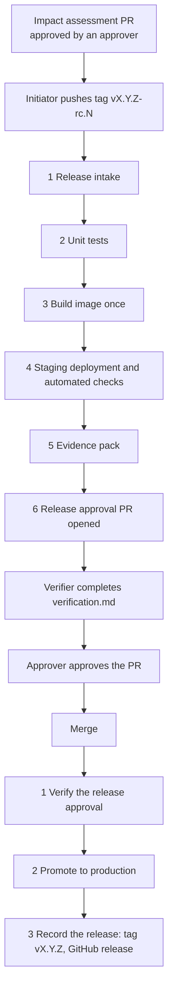

# GxP DevOps framework: design

| | |
|---|---|
| Status | Draft, describes framework v0.1 |
| Last updated | 2026-10-19 |
| Scope | Internally developed web applications built as container images and run on Azure |

## 1. Purpose

A reusable, versioned release process for GxP-relevant web applications. Each application repository calls the
framework's GitHub workflows. The framework controls the mandatory sequence: checks, a single build, staging
verification, evidence, human approval and promotion to production. It records which framework version
governed each release.

GitHub is the orchestration, dashboard and traceability layer. Official controlled documents and signatures
stay in the eQMS (Dot Compliance) and are referenced by ID. GitHub is not the QMS.

## 2. Principles

1. **Build once, promote the same artifact.** Each release candidate is built exactly once into one container
   image. The image digest (`sha256:…`) is its identity. STAGING and PRODUCTION run that digest; nothing is
   rebuilt for production.
2. **Configuration is not built in.** The image contains only immutable facts about the build (commit, build
   ID). Environment, release label and settings are supplied at deploy time. Non-secret configuration is
   versioned and its hash is recorded, because it is part of the validated state.
3. **Risk-based validation.** Every release gets a GxP impact assessment. The assessment, not the version
   number, decides the validation path (abbreviated, targeted, full). This follows the risk-based approach of
   FDA CSA and GAMP 5 (2nd edition).
4. **Two different people.** The person who starts or edits a release cannot approve it.
5. **Verify, don't trust.** The framework re-checks approvals, records and evidence through the GitHub API and
   SHA-256 hashes instead of trusting files or inputs supplied by the application repository.
6. **Visible and traceable.** Every stage is a named job with a summary. Every release ends with a release
   record linking requirement → test → result → approval → running image.

## 3. Architecture

### Repositories

| Repository | Contains |
|---|---|
| `gxp-devops-framework` | Reusable workflows (`gxp-candidate.yml`, `gxp-promote.yml`), this design, the changelog. Released as version tags (`v0.1.0`). |
| Application repo (e.g. `gxp-demo-app`) | Source, Dockerfile, tests, `deploy/*.env`, `.gxp/roles.yml`, `validation/<version>/`, two small caller workflows pinned to a framework version. |

### What an application must provide

| Item | Purpose |
|---|---|
| `Dockerfile` | Builds the image. Accepts build args `GIT_COMMIT` and `BUILD_ID`. |
| `GET /health` | Returns HTTP 200 when the application is up. |
| `GET /version` | Returns JSON with at least `commit`, `environment` and `release`. The framework uses it to verify what is actually running. |
| Runtime configuration | Reads `APP_ENVIRONMENT` and `APP_RELEASE_VERSION` (set by the framework) and its own settings from environment variables at startup. |
| Unit tests with JUnit XML | Test names start with the requirement ID they verify, e.g. `[URS-001] limits are inclusive`. |
| `deploy/staging.env`, `deploy/production.env` | Non-secret configuration per environment. |
| `.gxp/roles.yml` | Who may start releases (`initiators`) and approve them (`approvers`). |
| `validation/<version>/impact-assessment.yml` | Impact assessment, merged through an approved PR before the release starts. |

### System boundary

The target application architecture is a frontend container (built from Lovable) that talks to MuleSoft APIs,
which talk to a database in Azure. A release is validated against one combination of these. v0.1 builds and
promotes the frontend container only. Recording and checking the MuleSoft API and database schema versions is
planned (see roadmap).

## 4. Release flow

### Candidate workflow (`gxp-candidate.yml`, on tag push)

| Stage | What happens | Stops the release when |
|---|---|---|
| 1 Release intake | Identifies the framework version from the OIDC token. Checks the tag, that the commit is on the default branch, that the initiator is allowed, that the impact assessment is valid and was merged through an approved PR. | Framework not referenced by a version tag; tag not `vX.Y.Z-rc.N`; commit not on main; version already released; initiator not listed; impact assessment missing, invalid or not approved. |
| 2 Unit tests | Runs the app's tests, summarises JUnit results per requirement ID. | Any test fails, or no results are found. |
| 3 Build image once | Builds and pushes one image, records its digest, confirms the registry holds exactly that digest. | The candidate was already built (a re-run must not create a second image). |
| 4 Staging | Runs the image by digest with the staging configuration and checks: the running container uses the digest, `/health`, `/version` (commit, environment, release), home page text. | Any check fails. |
| 5 Evidence pack | Assembles `release-candidate.json` and all evidence with a `SHA256SUMS` list into one artifact. | Missing evidence or configuration. |
| 6 Release approval PR | Commits `release-candidate.json` and a `verification.md` template to `release/<tag>` and opens a PR. Closes older open release PRs as superseded. | |

### Promotion workflow (`gxp-promote.yml`, on merge of the release PR)

| Stage | What happens | Stops the release when |
|---|---|---|
| 1 Verify the release approval | Checks: exactly one release record changed; it is the latest candidate of its version and not released yet; `verification.md` says `Overall result: PASS`; the record is byte-identical to the candidate run's evidence and every evidence file matches its hash; the candidate run succeeded and was started by the recorded initiator; the record arrived through the release PR; the PR has a valid approval; someone other than the approver completed the verification. | Any check fails. |
| 2 Promote to production | Checks the production configuration hash and that the registry still holds the digest, runs the image by digest with production configuration, repeats the checks, tags the image with the version without changing the digest. | Any check fails. |
| 3 Record the release | Creates tag `vX.Y.Z` on the candidate's commit and a GitHub release with `release-record.json`, an evidence zip and `SHA256SUMS`. | |

## 5. Roles and segregation of duties

| Role | Typical person | Does |
|---|---|---|
| Initiator | Technical owner | Writes the impact assessment, pushes the release candidate tag. |
| Verifier | Technical owner or tester | Verifies the candidate, completes `verification.md` in the release PR. |
| Approver | Business / process owner (QA for high impact, if Quality requires it) | Approves the impact assessment PR and the release PR. |

Rules enforced by the framework:

- An approval counts only if the approver is listed in `.gxp/roles.yml` as it was before the PR, approved the
  final commit of the PR, did not open or contribute to the PR, and (for releases) did not start the release.
- A PR that changes `.gxp/roles.yml` cannot serve as an impact assessment or release approval.
- A "changes requested" review by an approver blocks the release.

Whether a release may be approved without QA is a decision for Quality (see open questions).

## 6. Records

| Record | Where | Written by |
|---|---|---|
| `validation/<v>/impact-assessment.yml` | Git, via reviewed PR | Initiator |
| `validation/<v>/release-candidate.json` | Git (release PR) and evidence artifact | Framework |
| `validation/<v>/verification.md` | Git (release PR) | Verifier |
| `release-record.json` | GitHub release asset and artifact | Framework |
| Evidence pack (`gxp-evidence-<tag>`) | Actions artifact, 90 days in v0.1 | Framework |

### Impact assessment (`gxp-impact-assessment/v1`)

| Field | Values |
|---|---|
| `version` | The release version, quoted (`"1.4.0"`) |
| `change_control_id` | eQMS change record ID |
| `summary`, `rationale` | Free text |
| `change_type` | `new-system`, `feature`, `fix`, `cosmetic`, `configuration`, `infrastructure` |
| `gxp_impact` | `none`, `low`, `medium`, `high` |
| `validation_path` | `abbreviated`, `targeted`, `full`. High requires full; medium requires targeted or full. |
| `impacted_requirements` | Requirement IDs; may be empty only when impact is `none` |

### Release record (`gxp-release-record/v1`)

Application, version, candidate tag, commit, initiator; framework version and commit for both candidate and
promotion; image reference and digest; impact assessment summary, hash and approval; configuration hashes;
unit test totals and requirement traceability; staging and production check results; release PR, verifiers
and approvers with timestamps; run links; release time.

## 7. Controls and enforcement

| Control | v0.1 mechanism | Later |
|---|---|---|
| Only approved changes reach production | Promotion re-verifies approvals through the API | Production Azure identity trusts only the framework's promotion workflow at approved versions (OIDC `job_workflow_ref`); protected `production` environment with required reviewers (Enterprise) |
| Same image in staging and production | Deploy by digest, compare running image, registry digest checks | Build provenance attestations, verified at promotion |
| Record and evidence not altered | Byte comparison with the candidate run's evidence, SHA-256 of every file | Evidence in write-once Azure Blob storage |
| Separation of duties | Approval rules in section 5 | Branch and tag rules, CODEOWNERS (Enterprise) |
| Framework version known | OIDC claims `job_workflow_ref` and `job_workflow_sha` | Immutable framework releases |
| Only the latest candidate | Newer candidates close older PRs; promotion rejects superseded tags | Staging deployment lock in Azure |

## 8. Known limitations of v0.1

- **STAGING and PRODUCTION are simulated** by running the image on the GitHub runner. Manual verification means
  reviewing the evidence or running the exact image locally by digest.
- **Repository rules are not enforced by GitHub** (free plan, private repos). Someone with write access can
  change the caller workflows or `.gxp/roles.yml` directly on main. v0.1 detects mistakes and casual
  tampering. Protection against a malicious repository writer comes from the Azure identity binding (v0.3)
  and Enterprise rules.
- **Approval is a PR review, not an electronic signature.** It is a technical release control that mirrors the
  formal approval in the eQMS.
- **Evidence retention is 90 days** (Actions artifacts) plus the GitHub release assets. Long-term retention
  needs write-once storage (v0.7).
- **No security scanning, Playwright, performance tests or attestations yet.**
- **Logic is duplicated** between the two workflows (framework identity, approval rules, checks) because a
  reusable workflow cannot read files from its own private repository without an extra token. To be
  consolidated once a GitHub App token is available.

## 9. Framework versioning

- The framework is released as tags `vMAJOR.MINOR.PATCH`. Applications pin a tag; the intake rejects branches.
- Pre-release tags (`v0.1.0-beta.1`) are allowed for testing and are flagged as "not for GxP use" in every
  record.
- Every framework change is itself a controlled change with an impact assessment for the consuming
  applications. A framework upgrade in an application is a change to that application's release process.
- Once Enterprise is available, framework releases are published as immutable releases.

## 10. Roadmap

| Version | Scope |
|---|---|
| v0.1 | Release flow on GitHub with simulated environments, PR-based approval, evidence and release record |
| v0.2 | Protected `production` environment gate (Enterprise), central roles registry, change report since the last release flagging GxP-critical paths |
| v0.3 | Azure: ACR, OIDC login, Container Apps staging and production by digest, identity bound to framework version, runners inside the Azure network |
| v0.4 | Security: Semgrep, gitleaks, Trivy (dependencies, image, SBOM), build attestations, vulnerability policy with documented exceptions |
| v0.5 | Playwright end-to-end, authorization and performance tests against staging; full traceability matrix |
| v0.6 | Test selection by impact assessment; MuleSoft API and database schema versions in the record |
| v0.7 | Write-once evidence storage, production drift check |
| v0.8 | Emergency change, rollback and configuration-only change paths |
| v1.0 | The framework's own validation package and a pilot application |

## 11. Decision log

| ID | Decision | Reason |
|---|---|---|
| D-01 | Build once, deploy by digest | The validated artifact must be the one in production. |
| D-02 | Releases start with a pushed tag `vX.Y.Z-rc.N` | Team preference; prerequisites are checked at intake. |
| D-03 | Approval through a pull request, re-verified by the framework | Works without Enterprise, has no 30-day wait limit, keeps the approval in git next to the digest. |
| D-04 | Release label and environment supplied at deploy time | Promoting without rebuilding must not leave "rc" in production. |
| D-05 | Impact assessment merged before the candidate is built | Scope is agreed before testing starts. |
| D-06 | A new candidate supersedes all open candidates | Staging holds one candidate at a time. |
| D-07 | Framework pinned by tag, identified through OIDC claims | The calling repository cannot misreport the framework version. |
| D-08 | Lovable preview is the DEV environment; the framework manages STAGING and PRODUCTION | Development happens in Lovable. |
| D-09 | Open-source scanners in v0.4 | GitHub code scanning is a paid add-on even with Enterprise. |
| D-10 | eQMS stays the system of record; GitHub references its IDs | GitHub approvals are not Part 11 signatures. |

## 12. Open questions

1. Can releases be approved by the business/process owner, with QA only for high-impact changes? (Quality)
2. Evidence retention period. (Quality)
3. Position on AI-generated code from Lovable. (Quality)
4. Enterprise Managed Users or regular accounts with SSO; does Lovable work with managed users?
5. Lovable on a `develop` branch with release PRs into main, or Lovable on main?
6. Ownership of MuleSoft deployments and database schema changes; is there a staging MuleSoft environment?
7. Must any application go live before the Supabase migration?
